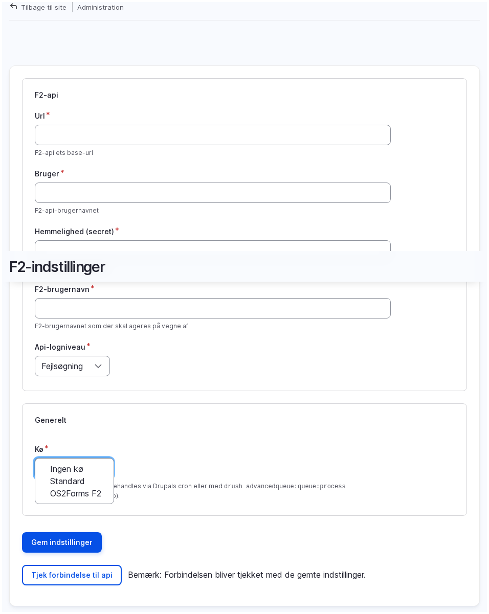
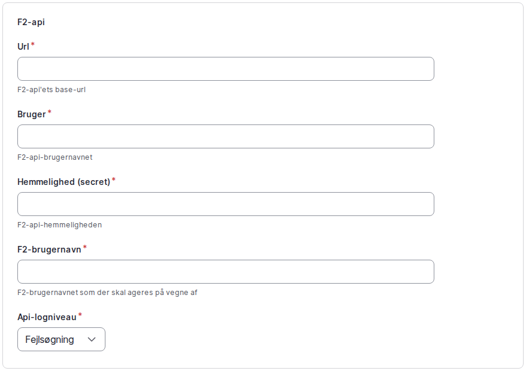
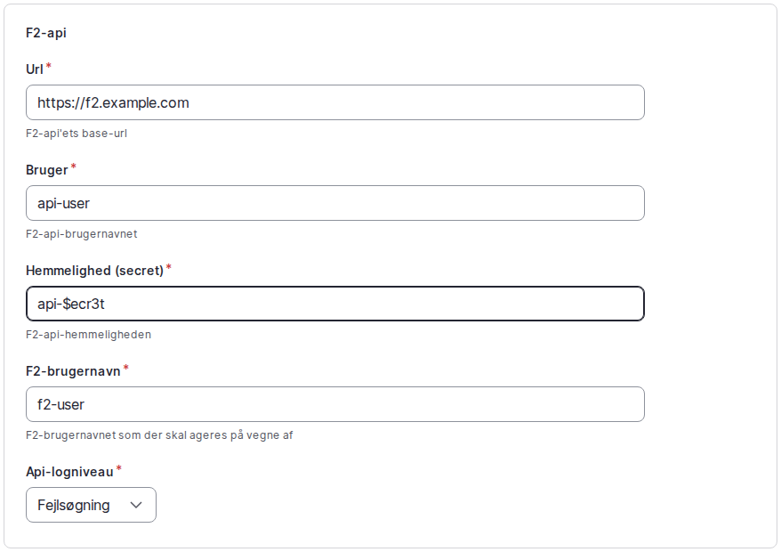
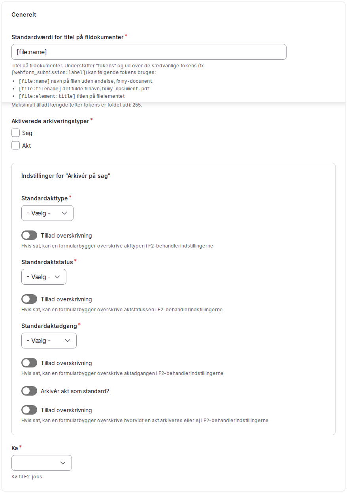
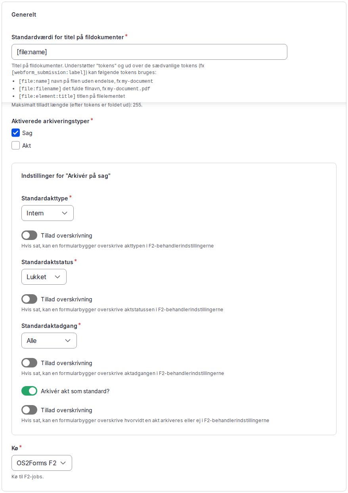

# Administrator

Generelle indstillinger for F2-modulet laves under Administration > Indstillinger > OS2Forms F2
(`/admin/os2forms_f2/settings`):

## F2-api

Under F2-api konfigureres forbindelsen til F2's api:

Passende værdier for "Url", "Bruger", "Hemmelighed" og "F2-brugernavn" kan udleveres af en F2-administrator, fx

Når F2-api-indstillingerne er gemt kan man tjekke at der er hul igennem til api'et ved at trykke på "Tjek forbindelse
til api":

Når man indsætter gyldige og korrekte værdier skulle der gerne være hul igennem til api'et:

## Generelt

Under Generelt kan en administrator sætte standardindstillinger for F2-behandlere og styre om en formularbygger skal
kunne overskrive en standardindstilling.

Restriktive, men fornuftige, standardindstillinger kan fx være

En formularbygger vil så ikke skulle forholde sig til om der skal arkiveres på en sag eller på en akt, og akter der
oprettes får de egenskaber (fx type og status) som administratoren har sat.
