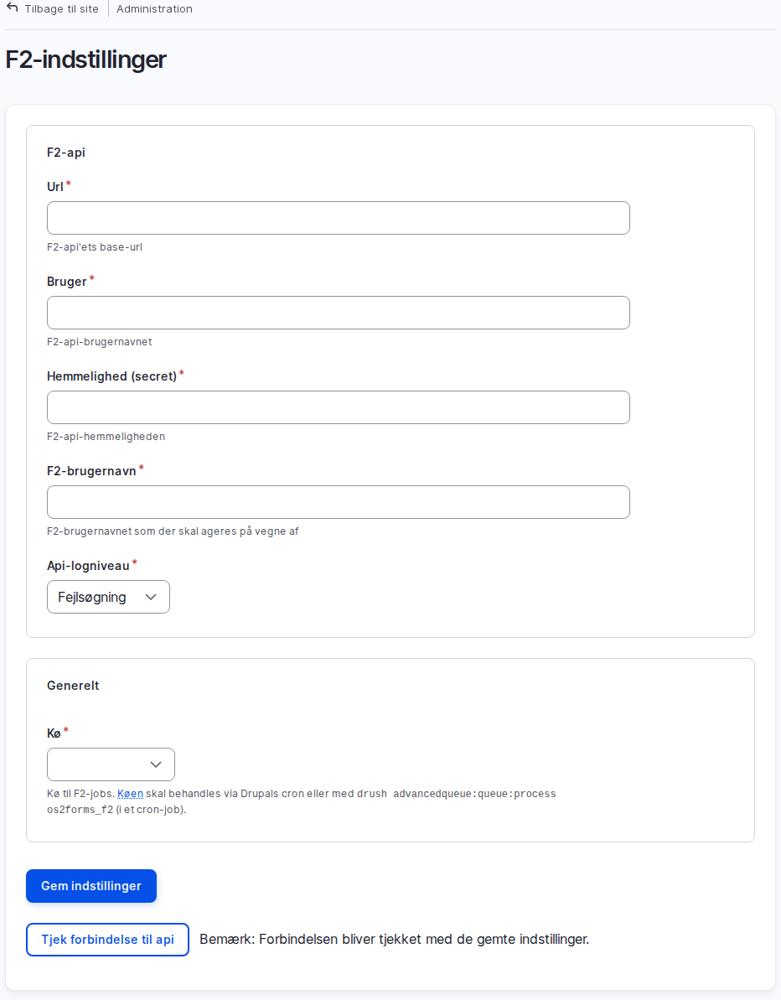
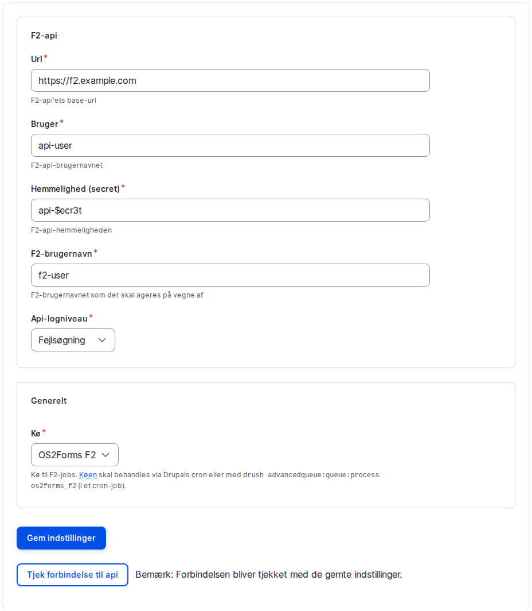
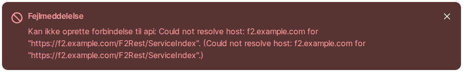

# Administrator

Generelle indstillinger for F2-modulet laves under Administration > Indstillinger > OS2Forms F2
(`/admin/os2forms_f2/settings`):

Passende værdier for "Url", "Bruger", "Hemmelighed" og "F2-brugernavn" kan udleveres af en F2-administrator, fx

Når indstillingerne er gemt kan man tjekke at der er hul igennem til api'et ved at trykke på "Tjek forbindelse til api":

Når man indsætter gyldige og korrekte værdier skulle der gerne være hul igennem til api'et:

