# Formularbygger

F2-behandleren kan arkivere indholdet i et vedhæftningselement (OS2Forms Attachment) som et dokument i F2. Behandleren
indsættes ligesom andre behandlere

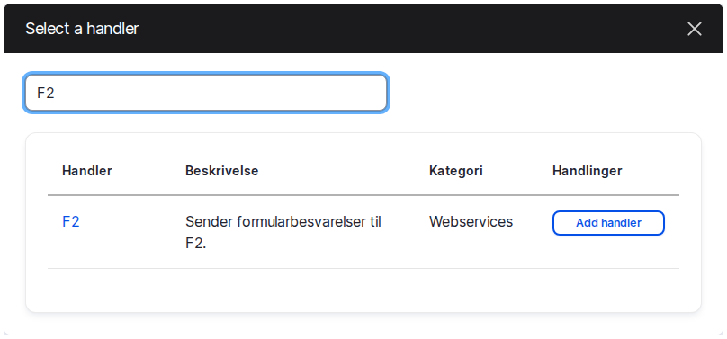

og konfigureres på passende vis.

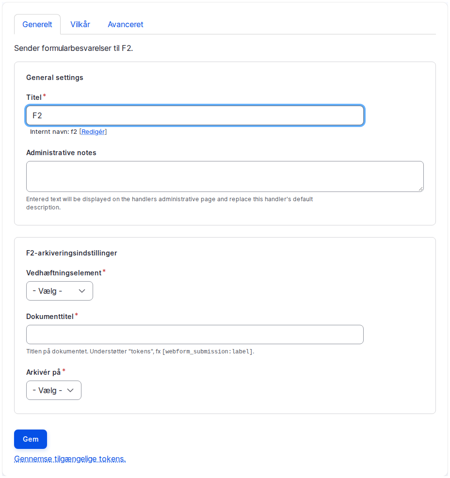

De afgørende indstillinger for F2-behandleren ligger under "F2-arkiveringsindstillinger":

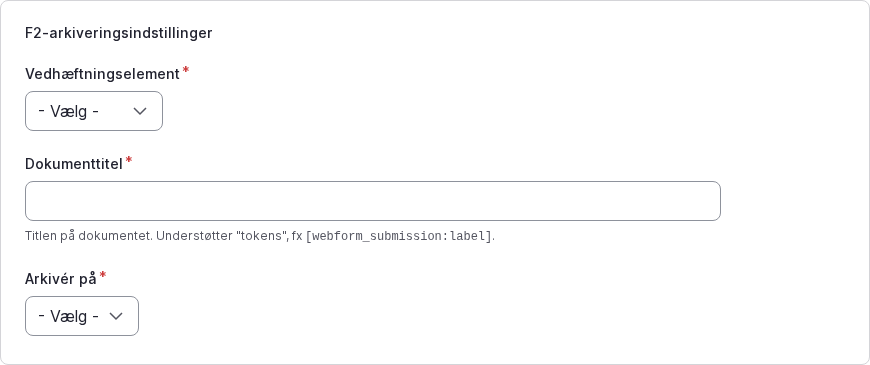

Vælg et vedhæftningselement (af typen "OS2Forms Attachment") og angiv en titel på dokumentet der arkiveres i F2:

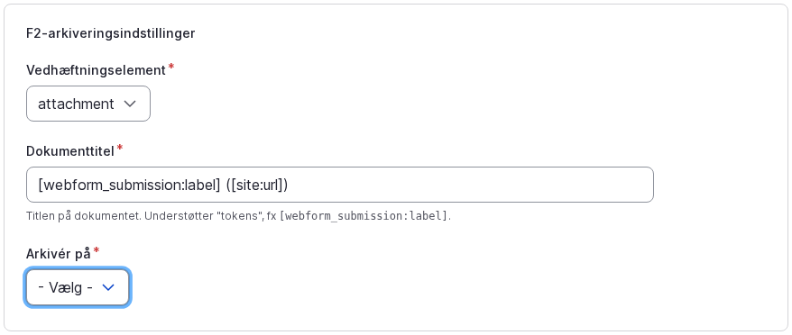

Under "Arkivér på" kan man vælge "[Sag](#arkivering-på-sag)" eller "[Akt](#arkivering-på-akt)" og valget har indflydelse
på yderligere muligheder i behandlerindstillingerne.

## Arkivering på sag

Som bekendt ligger dokumenter i F2 på en akt, og for at arkivere på en sag opretter behandleren derfor indledningsvist
en akt som dokumentet kan knyttes til. For at arkivere på en sag skal man angive et id der entydigt udpeger en sag i F2.
Det vil være oplagt at bruge et sags-nummer

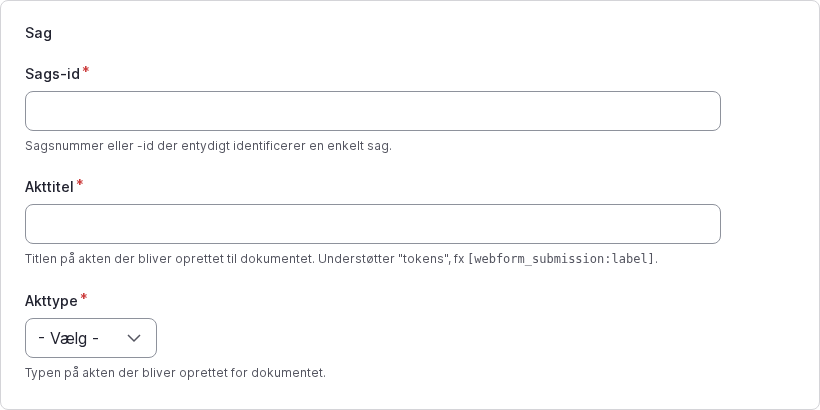

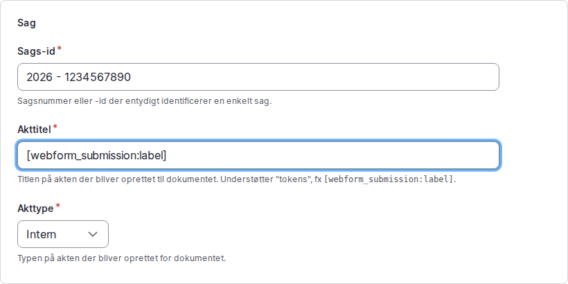

Når man gemmer tjekker systemet at sags-id'et entydigt identificerer en sag i F2:

Hvis id'et entydigt identificerer en sag i F2, så har man med succes tilføjet en F2-behandler:

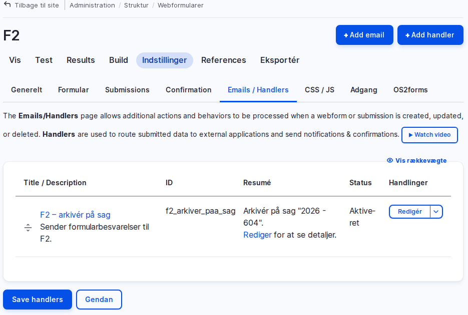

Hvis man, som antydet, redigerer en F2-behandler kan man se detaljer om hvilken sag der faktisk arkiveres på:

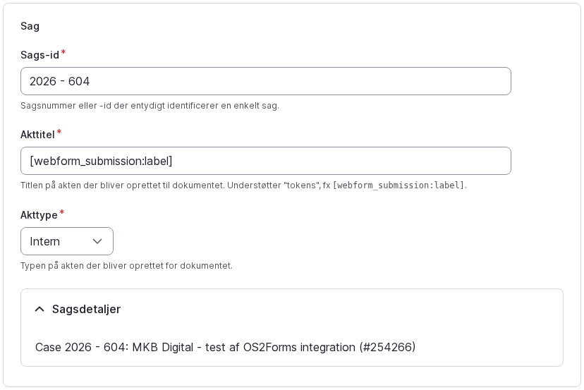

## Arkivering på akt

Når man vil arkivere på en (eksisterende) akt skal man angive et id, fx akt-nummer, der entydigt udpeger akten i F2.

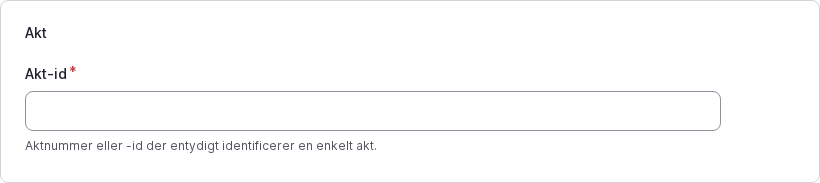

Når man gemmer tjekker systemet at akt-id'et entydigt identificerer en akt i F2:

Hvis id'et entydigt identificerer en sag i F2, så har man med succes tilføjet en F2-behandler:

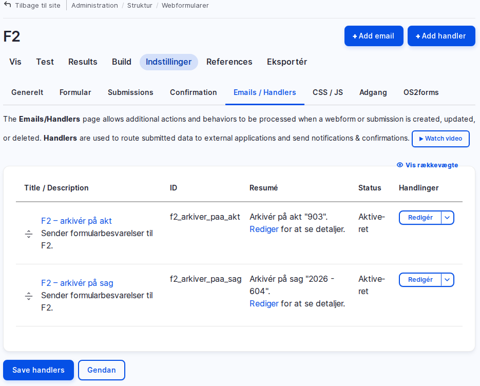

Når man redigerer behandleren, kan man se detaljer om den akt der arkiveres på:

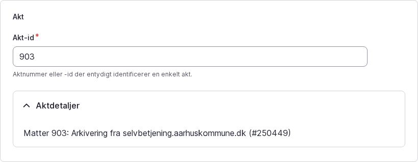

## Avancerede indstillinger

På fanen "Avanceret" kan man styre hvornår behandleren skal arkivere i F2:

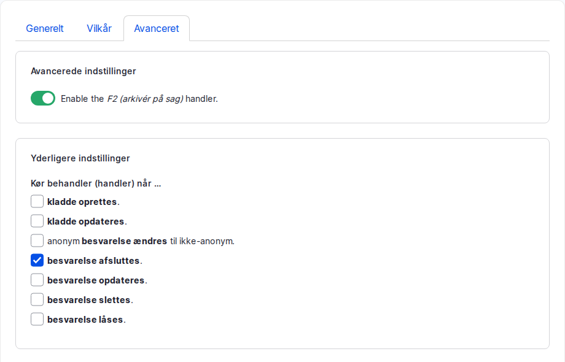

> [!NOTE]
> Standardindstillingen, "Kør når … besvarelse afsluttes", vil oftest være det rigtige valg og kun i sjældne tilfælde
> vil det være nødvendigt at vælge noget andet.
